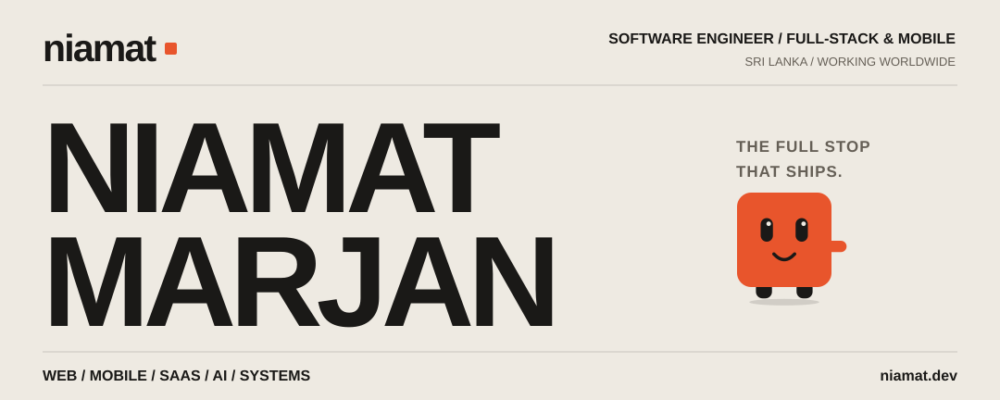
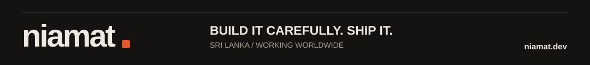

<a href="https://niamat.dev">
  <picture>
    <source media="(max-width: 600px)" srcset="./assets/header-mobile.svg">
    
  </picture>
</a>

## Hey, I'm Niamat.

**Software Engineer · Full-Stack & Mobile Developer**

I'm a software engineer in **Sri Lanka, working worldwide**. I build web and mobile applications, SaaS platforms, AI integrations, and the systems that keep them running.

I care about the interface, the architecture underneath it, and what happens after launch. **Build it carefully. Ship it. Keep it working.**

**[Explore my portfolio](https://niamat.dev)** · [Play with Bit](https://niamat.dev/playground) · [Résumé](https://niamat.dev/niamatmarjan-resume.pdf) · [Book an intro](https://cal.com/niamat/intro)

---

## What I build.

| Focus | What I work on |
| :--- | :--- |
| **Product engineering — web & mobile** | SaaS platforms, MVPs, Next.js applications, React Native apps, websites, and responsive interfaces. |
| **AI engineering & automation** | AI features, agents, RAG, semantic search, LLM integrations, and reviewable automated workflows. |
| **Backend, systems & real-time** | APIs, PostgreSQL, WebSockets, queues, payment integrations, cloud infrastructure, and CI/CD. |

I work across the stack rather than treating the frontend, backend, and deployment as separate problems. [**See my services and interactive demos →**](https://niamat.dev/services)

## A portfolio with a little personality.

I wanted my site to be more than a list of technologies and screenshots. It has editorial motion, responsive experiments, interactive engineering demos, and a small resident named **Bit** — the full stop in **niamat.** that wandered off the page.

In the [**Playground**](https://niamat.dev/playground), you can pull typography apart, experiment with physics, finish a sentence with Bit, make a beat, and discover a few surprises. The site itself is part of the craft.

[**Experience the website →**](https://niamat.dev) · [**Explore the Playground →**](https://niamat.dev/playground)

<strong>Selected work and case studies</strong>

- **[Snapvyn](https://niamat.dev/work/snapvyn)** — event media sharing, QR capture, and real-time experiences.
- **[Menuvyn](https://niamat.dev/work/menuvyn)** — QR menus, shared table ordering, kitchen displays, and cloud POS.
- **[Harriet Shopping](https://niamat.dev/work/harriet-shopping)** — multi-vendor e-commerce marketplace.
- **[ZRI Adventures](https://niamat.dev/work/zri-adventures)** — travel experiences and booking flows.

[Browse all case studies →](https://niamat.dev/work)

## Tools I work with.

| Area | Stack |
| :--- | :--- |
| **Interfaces** | TypeScript, React, Next.js, React Native, Tailwind CSS, GSAP |
| **APIs & services** | Node.js, NestJS, Fastify, Python / FastAPI, C# / .NET |
| **Data & real-time** | PostgreSQL, Supabase, SQL Server, Redis, BullMQ, WebSockets |
| **Cloud & delivery** | Docker, AWS, Azure, Cloudflare, Vercel, GitHub Actions |
| **AI systems** | LLM integrations, RAG, AI agents, workflow automation |

<strong>How I take a product from idea to live</strong>

**Scope → Architect → Build → Harden → Hand over.**

Understand the problem, plan architecture and deployment, ship working increments, test important paths and failure states, and leave maintainable systems.

## A little signal from GitHub.

<a href="https://github.com/niamatmarjan?tab=overview">
  <picture>
    <source media="(max-width: 600px) and (prefers-color-scheme: dark)" srcset="./assets/activity-mobile-dark.svg">
    <source media="(max-width: 600px)" srcset="./assets/activity-mobile-light.svg">
    <source media="(prefers-color-scheme: dark)" srcset="./assets/activity-dark.svg">
    
  </picture>
</a>

Generated from GitHub's profile and contribution data. Refreshed daily. [Explore my repositories →](https://github.com/niamatmarjan?tab=repositories)

---

### Have something in mind?

Open to **remote roles and select projects** — from new products to existing systems that need their next chapter.

**[Book a call](https://cal.com/niamat/intro)** · [Email](mailto:mniamatmarjan@gmail.com) · [LinkedIn](https://www.linkedin.com/in/niamatm/) · [niamat.dev](https://niamat.dev)

