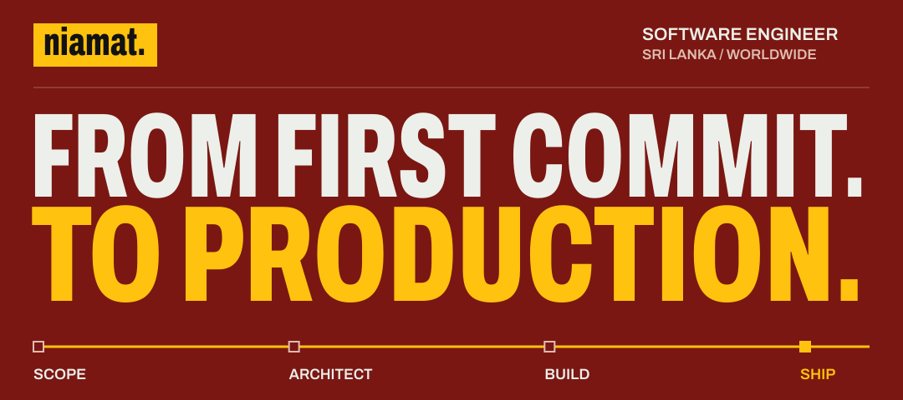
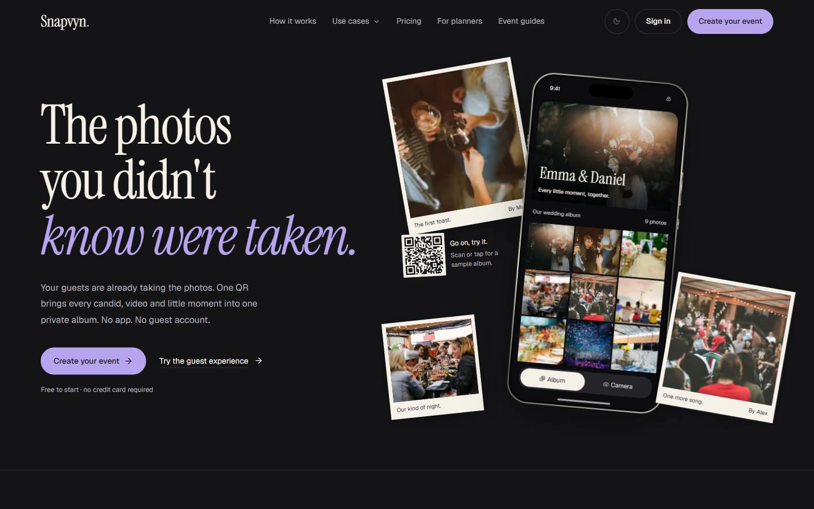
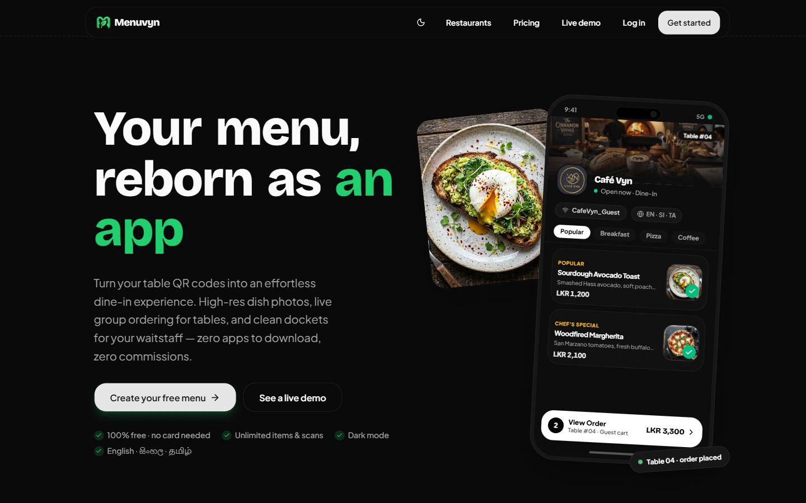
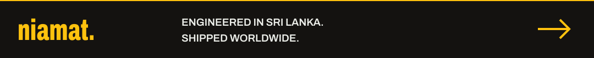

<a href="https://niamat.dev">
  <picture>
    <source media="(max-width: 600px)" srcset="./assets/header-mobile.svg">
    
  </picture>
</a>

# Hey, I'm Niamat.

**Software engineer · Full-stack & mobile developer · Founder of [iVynLabs](https://www.ivynlabs.com)**

I turn ideas into software people can actually use. Based in **Sri Lanka**, working worldwide — building SaaS platforms, mobile apps, custom websites, and AI systems. I care about the pixels, the architecture, and what happens after launch.

Currently building **[Snapvyn](https://www.snapvyn.com)** and **[Menuvyn](https://www.menuvyn.com)**, alongside select client projects.

**[Explore my portfolio →](https://niamat.dev)** &nbsp; / &nbsp; [Book an intro](https://cal.com/niamat/intro) &nbsp; / &nbsp; [Email me](mailto:mniamatmarjan@gmail.com) &nbsp; / &nbsp; [LinkedIn](https://www.linkedin.com/in/niamatm/)

---

## Built. Shipped. Still building.

### Snapvyn / Every guest. Every angle.

Scan a QR. Capture the moment. Watch it hit the live photo wall. Event photo and video sharing with browser uploads, disposable camera mode, and AI highlights. **No app download required.**

**Founder & sole engineer** · Next.js · NestJS / Fastify · PostgreSQL · Redis / BullMQ · Socket.IO · Cloudflare R2

[Visit Snapvyn →](https://www.snapvyn.com) &nbsp; · &nbsp; [Behind the build](https://niamat.dev/work/snapvyn)

### Menuvyn / From table to kitchen, in real time.

A restaurant operating system connecting QR menus, group ordering, kitchen displays, and cloud POS. Built for the diner, the kitchen, and the person running the floor. **Zero apps. Zero commissions.**

**Founder & sole engineer** · Next.js · React · TypeScript · Supabase / PostgreSQL · Realtime · LankaQR

[Visit Menuvyn →](https://www.menuvyn.com) &nbsp; · &nbsp; [Behind the build](https://niamat.dev/work/menuvyn)

<strong>More work, beyond the flagship products</strong>

| Project | What I built | My role |
| :--- | :--- | :--- |
| [**Harriet Shopping** →](https://harrietshopping.com) | Multi-vendor marketplace: storefronts, catalogue, checkout, and fulfilment. | Lead engineer |
| [**iVynLabs** →](https://www.ivynlabs.com) | The studio and product home for the Vyn family. | Founder, design & build |
| [**ZRI Adventures** →](https://www.zriadventures.com) | Travel discovery, itinerary planning, and guided-trip booking. | Frontend & booking flow |

[Explore all case studies →](https://niamat.dev/work)

## The tools change. The craft stays.

| What I'm building | What I reach for |
| :--- | :--- |
| **Web & mobile** | TypeScript, React, Next.js, React Native, Tailwind CSS, GSAP |
| **APIs & services** | Node.js, NestJS, Fastify, C# / .NET, Python / FastAPI |
| **Data & real time** | PostgreSQL, SQL Server, Supabase, Redis, BullMQ, WebSockets |
| **Cloud & delivery** | Docker, Azure, AWS, Cloudflare, Vercel, GitHub Actions |
| **AI & automation** | LLM integration, RAG, AI agents, background workflows |

<strong>How I take a product from idea to live</strong>

**Scope → Architect → Build → Harden → Hand over.**

Start with the real problem and a written brief. Decide the data model and deployment story early. Ship to a real environment from week one. Build in error handling, performance, and observability. Leave a system a team can maintain.

I can help with SaaS architecture, web and mobile development, AI integration, payment flows, and the infrastructure that keeps it all running.

## A little signal from GitHub.

<a href="https://github.com/niamatmarjan?tab=overview">
  <picture>
    <source media="(max-width: 600px) and (prefers-color-scheme: dark)" srcset="./assets/activity-mobile-dark.svg">
    <source media="(max-width: 600px)" srcset="./assets/activity-mobile-light.svg">
    <source media="(prefers-color-scheme: dark)" srcset="./assets/activity-dark.svg">
    
  </picture>
</a>

Generated daily from GitHub. [Explore the code →](https://github.com/niamatmarjan?tab=repositories)

---

## Your next idea could be the next thing I ship.

Open to **select client projects and thoughtful collaborations** — whether you're starting with a rough idea, a product that needs its next chapter, or a system that needs to scale.

**[Let's talk →](https://cal.com/niamat/intro)** &nbsp; · &nbsp; [mniamatmarjan@gmail.com](mailto:mniamatmarjan@gmail.com) &nbsp; · &nbsp; [Résumé](https://niamat.dev/niamatmarjan-resume.pdf)

> Shipped beats perfect — but shipped and solid beats both.

